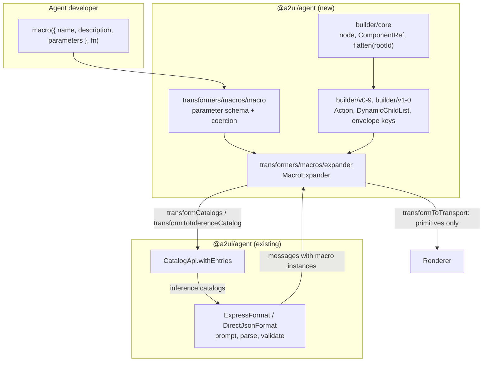

# A2UI macros for the TypeScript Agent SDK (upstream port plan)

Status: plan only, 2026-11-11. Nothing implemented, no upstream contact yet.
Checked against `a2ui-project/a2ui` main `2341bb68` (2026-11-11), Python
`a2ui_agent` 0.11.0, `@a2ui/agent` 0.1.0.

Goal: port the Python macro runtime (`@macro`, `MacroExpander`) and the
typesafe builder it depends on to `typescript/agents/a2ui_agent`, pass the
shared conformance suites, and get it merged. flights42 then replaces
`ai-server/src/mastra/a2ui/interim-macros/` and the hand-written
`dashboard-dsl/compile-dashboard.ts` with SDK macros.

## Situation upstream

- Python has both features: `a2ui.builder` (core runtime, v0.9 and v1.0
  models, generated basic-catalog classes) and `a2ui.transformers.macros`
  (`macro.py`, `processor.py`, `expander.py`, 2643 lines).
- TypeScript has neither. `tests/conformance/unsupported-suites.test.ts`
  lists `agent/builder/builder.yaml` and `agent/macros/macros.yaml` under
  `UNSUPPORTED_SUITES` ("Python-only helper not implemented in TypeScript");
  `conformance/features.yaml` records the same as a `knownGaps` entry for
  `ts-agent` on feature `F-AGT-26`.
- Maintainers treat both as optional. Issue #3455 (TS macros missing) was
  closed for lack of capacity around the v1.0 launch. The conformance audit
  #3842 rates them "Should fix? No (`L + L` if ever opted into)", where `L`
  is 1 to 2 human weeks. PR #2613 (TS CLI plus builder proposals) was closed
  with "we have Dart builders so we don't need TypeScript builders".
- The target is moving:
  - #4170 and #4171 (open) cut v1.0 over to `@child`, `@action` and
    `@functionCall`. #4171 rewrites the v1.0 macro and builder goldens. v0.9
    is untouched.
  - RFC #2865 (open) replaces `CatalogTransformer` with
    `CatalogMessageTransformer` and a `TransformerPipeline` on
    `A2uiGenerator`. `MacroExpander` is its main example.
  - #2748 and #2898 (open) concern macro error handling and pre-inference
    verification.
  - The macro suite grew from 18 to 70 cases between the audit and today.

Consequence: an unannounced large PR is likely to be declined or to rot.
Agreement on scope and slicing comes first (phase 0).

## What has to be ported

| Part                                                                                                                                | Python reference                                                         | Conformance                                                            |
| ----------------------------------------------------------------------------------------------------------------------------------- | ------------------------------------------------------------------------ | ---------------------------------------------------------------------- |
| Builder core: `ComponentBuilderNode`, `ComponentRef`, `IdAllocator`, two-pass `flatten_component_tree`, `ComponentTree`, open enums | `builder/core/` (459 lines)                                              | `builder.yaml`, 22 cases, goldens for v0.9 and v1.0                    |
| Builder models per version: `Action`, `DynamicChildList`, `Dynamic*` unions, envelope keys                                          | `builder/v0_9/`, `builder/v1_0/` (about 800 lines hand-written)          | same                                                                   |
| Basic-catalog component classes                                                                                                     | `builder/*/catalogs/basic.py` (1234 lines, generated by `dart/a2ui_cli`) | same                                                                   |
| Macro definition: parameter types to JSON Schema, argument coercion                                                                 | `macro.py` (937), `processor.py` (657)                                   | `macros.yaml`: 20 catalog-synthesis cases                              |
| `MacroExpander`: catalog transforms, expansion, catalog resolution, envelope merge, error modes                                     | `expander.py` (1026)                                                     | `macros.yaml`: 50 transport cases, 34 with goldens, 18 expected errors |

`macros.yaml` defines 32 reference macros as declarative templates; the
Python harness that interprets them (`macro_suite.py`) is 1044 lines.

## Design

Decisions, each with the reason and what would change it:

1. **Same public names as Python, camelCased.** `macro`, `MacroExpander`,
   `transformCatalogs`, `transformToInferenceCatalog`, `toCatalog`,
   `transformToTransport`, options `passthroughComponents`, `catalogId`,
   `baseCatalogs`, `protocolVersion`, `onError`. The conformance suite is
   written against these operations, and it keeps docs portable.
2. **Parameters are declared, not inferred.** TypeScript has no runtime
   annotations, so `@macro`'s signature inspection cannot be ported. A macro
   declares its parameters with a small typed vocabulary that mirrors the
   table in `conformance/agent/macros/README.md` (`string`, `integer`,
   `number`, `boolean`, `component`, `componentList`, `childList`, `action`,
   `dynamicString`, `dynamicNumber`, `dynamicBoolean`, `dynamicStringList`,
   `dynamicValue`, `checkRuleList`, `accessibility`, plus enum, default,
   optional, object, array and union). The macro function's argument type is
   inferred from that declaration. This makes schema synthesis and coercion
   one table and lets the harness build the 32 reference macros directly
   from YAML. Zod was considered and rejected as the primary form: it cannot
   express slot and action semantics without extra markers, and the package
   has no direct Zod dependency today.
3. **Builder: explicit two-pass walker** (blueprint approach A), plain
   objects in, wire dictionaries out, shared-instance deduplication by
   reference identity, IDs `{prefix}_{ComponentType}_{counter}`.
4. **Catalog component classes are the open question.** The blueprint
   expects generated classes from a new TypeScript emitter in
   `dart/a2ui_cli`. That is Dart work, a second review audience, and the
   reason PR #2613 died. Proposal to maintainers: ship the core runtime with
   a generic, catalog-validated node factory first (enough for macros and
   for both suites), and treat generated typed classes as a follow-up.
   Phase 0 settles this; if they insist on the emitter, add a phase between
   1 and 2 and roughly one more week.
5. **Macros stay synchronous**, as in Python. Data needed by a macro is
   resolved before expansion. An async variant is a possible later proposal,
   not part of this port.
6. **`MacroExpander` also implements today's `CatalogTransformer`**
   (`transform` delegates to `transformToInferenceCatalog`), so it plugs
   into `CatalogConfig` now and can move to RFC #2865's interface later
   without a public break.
7. **v0.9 first, v1.0 last.** v0.9 goldens are stable; v1.0 waits until
   #4171 lands so the envelope and directive keys are ported once.
8. **Follow the conformance suite where it disagrees with Python**, and
   record each difference in `KNOWN_GAPS.md`. That is the package's
   documented rule for Express.

Repository conventions that apply: kebab-case files, all `@a2ui/web_core`
imports through `src/internal/web-core.ts`, vitest, no bundled catalog,
`CHANGELOG.md` entry per PR, PR rules in `.agents/skills/pr-hygiene`.

## Phases

Each phase is one pull request and leaves `yarn test`, `yarn lint`,
`yarn typecheck` and `yarn format:check` green.

**Phase 0: agreement and spike (no PR)**

- Sign the Google CLA. Fork, clone to `~/projects/trainings/a2ui`.
- Comment on #3455 (or open a new issue referencing it and #3842) with the
  design above and the slicing below. Questions to get answered: is the
  feature wanted in `@a2ui/agent`; decision 4; root exports or a subpath
  export; wait for #4171 before v1.0 or not; relation to RFC #2865.
- Spike, throwaway: build one inference catalog with an added component via
  `CatalogApi.withEntries` and run it through `ExpressFormat` parse and
  validation. Confirms that a macro schema synthesized as JSON Schema can
  become a `ComponentApi` without new `web_core` API. If it cannot, a small
  `web_core` change becomes part of phase 2.
- Stop here if maintainers decline. Fallback is the local v0.9-only port in
  flights42 with the same names (plan B).

**Phase 1: builder runtime and `builder.yaml`**

- `src/builder/core/`: node base, `ComponentRef`, `IdAllocator`,
  `flattenComponentTree` (reservation scan, post-order emit, forest input,
  `rootId` anchoring), `ComponentTree`.
- `src/builder/v0-9/`, `src/builder/v1-0/`: `Action` with mutual exclusion,
  `DynamicChildList` with template subtree, strict `Dynamic*` handling,
  envelope keys per version.
- Harness `tests/conformance/builder-conformance.test.ts`: interpret the
  `$bind`, `$componentRef`, `$dynamicChildList`, `$action`, `$checkRule`,
  `$accessibility`, `$tabItem`, `$choiceOption` sentinels; assert golden
  equality and `MessageProcessor` validation per case. v1.0 cases are
  enabled only if #4171 has landed, otherwise listed as unsupported with
  that reason.
- Unit tests required by the blueprint: undeclared property, invalid enum,
  no cross-branch coercion in `Dynamic*`, `Action` with neither or both
  branches, ID reservation, shared instance emitted once, no materialized
  defaults.
- Move `agent/builder/builder.yaml` from `UNSUPPORTED_SUITES` to
  `ACTIVE_SUITES`.

**Phase 2: macro definition and catalog synthesis**

- `src/transformers/macros/macro.ts`: `macro()`, parameter vocabulary,
  JSON Schema synthesis per protocol family, description handling, v1.0
  name rules (UAX #31 identifier, reserved `Surface`).
- `MacroExpander` constructor, `toCatalog`, `transformToInferenceCatalog`,
  `transformCatalogs`, `passthroughComponents`, collision detection,
  protocol-family detection and the mixed-version errors.
- Harness part 1: build the reference macros from `macros.yaml` templates
  (`$param`, `$spreadParam`, `${name}` interpolation, the imperative notes
  such as `status.upper()`); run the 20 non-transport cases.

**Phase 3: expansion on v0.9**

- `transformToTransport` for `createSurface`, `updateComponents`,
  `deleteSurface`: argument coercion, root stitching (instance ID becomes
  the expanded root ID), slot boundaries (external child IDs are never
  renamed or re-emitted), nested macros with depth limit 16, multiple
  instances, mixed primitive and macro lists, `accessibility` and `checks`
  merged onto the expanded root, surface tracking with the 256-surface cap
  and the `surfaceCatalogs` override, `onError` `passthrough` and `raise`.
- Enable the v0.9 transport cases and the v0.9 expected-error cases.
- This phase is what flights42 needs. A prerelease after it unblocks the
  migration there.

**Phase 4: v1.0**

- `@catalogId`, `@accessibility`, `@metadata`, `@checks` with legacy
  bare-key read and the declared-parameter exception; deep merge of
  `metadata.extensions`.
- Component-to-catalog resolution (explicit, inherited from the enclosing
  macro, surface default, scoped expander), sidecar macro catalog,
  rewriting `createSurface.catalogId`, stamping lowered primitives from
  `baseCatalogs`, the ambiguity and missing-owner errors.
- `@path`, `@call`, and, once #4171 is in, `@child`, `@action`,
  `@functionCall`.
- Enable the remaining cases; `agent/macros/macros.yaml` moves to
  `ACTIVE_SUITES`.

**Phase 5: documentation and bookkeeping**

- `README.md` section and `src/transformers/macros/README.md` equivalent
  with a TypeScript example.
- Remove the `ts-agent` gap for `F-AGT-26` in `conformance/features.yaml`,
  update `KNOWN_GAPS.md`, add `typesafe_builder_api` with its commit hash
  to `implemented_features` in
  `blueprints/codebases/typescript/agents/a2ui_agent/codebase.blueprint.md`,
  run `python3 blueprints/validate_blueprints.py` and
  `conformance/scripts/check_feature_coverage.py`.

**Phase 6: flights42**

- Upgrade `@a2ui/agent`, define the ten dashboard tiles and `Dashboard` as
  macros, keep the data prefetch in front of expansion, delete
  `interim-macros/` and the tile builders in `compile-dashboard.ts`.
  `CompiledDashboard` stays the seam to the route.

## Verification

- Shared suites: 22 builder cases and 70 macro cases, golden equality by
  parsed JSON plus `MessageProcessor` validation under each case's profile.
  The invariant test in `unsupported-suites.test.ts` already fails if a
  suite is neither active nor listed as unsupported.
- Differential check against Python, kept out of the PRs: a script feeds
  the same macro inputs to the Python expander (`uv run`) and the
  TypeScript one and diffs the output. Only 34 of the 70 cases have
  goldens; this covers coercion and resolution paths the goldens miss.
- Per phase: no case enabled by skipping assertions. A case that cannot
  pass yet stays in the per-case unsupported map with a reason.

## Risks

| Risk                                              | Handling                                                         |
| ------------------------------------------------- | ---------------------------------------------------------------- |
| Maintainers do not want the feature in TypeScript | Phase 0 gate; fall back to plan B                                |
| Emitter in `dart/a2ui_cli` is required            | Extra phase; decide in phase 0                                   |
| #4171 lands mid-port and rewrites v1.0 goldens    | v1.0 is the last phase; rebase before starting it                |
| RFC #2865 changes the transformer interface       | Decision 6; keep expander internals independent of the interface |
| Review latency of several weeks per PR            | Phases 1 and 2 are independent and can be open in parallel       |
| Suite keeps growing                               | Re-count cases at the start of each phase                        |

## Effort

Reference volume: about 3900 lines of hand-written Python source, 1350
lines of harness, 2900 lines of unit tests. Expected TypeScript output is
of the same order.

| Phase                        | Agent runtime | Model     |
| ---------------------------- | ------------- | --------- |
| 0 spike and issue text       | 1 to 2 h      | Fable 5.2 |
| 1 builder                    | 4 to 6 h      | Opus 5.5  |
| 2 macro definition, catalogs | 4 to 6 h      | Fable 5.2 |
| 3 expansion v0.9             | 4 to 6 h      | Fable 5.2 |
| 4 v1.0                       | 5 to 8 h      | Fable 5.2 |
| 5 docs, bookkeeping          | 1 to 2 h      | Opus 5.5  |
| 6 flights42                  | 2 to 3 h      | Opus 5.5  |

These are estimates, not measurements. Total is roughly 20 to 35 hours of
agent runtime across at least seven sessions, plus review rounds. Calendar
time is set by upstream review, realistically one to two months. For
comparison, the maintainers' own estimate for a human is `L + L`, two to
four weeks.
